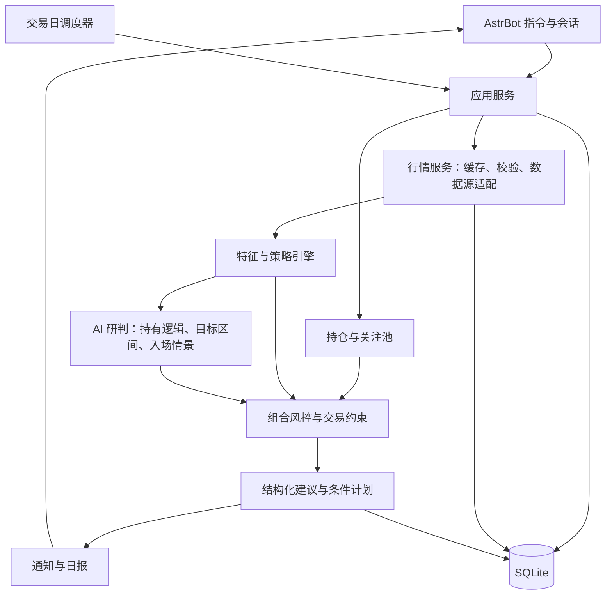

# StockWatcher 首版架构与实施计划

日期：2026-10-17。状态：讨论稿，尚未实现。

当前架构已足以启动集成与数据验证。具体执行顺序、交付物、依赖、状态及用户参与时点以 [分步实施计划表](./ROADMAP.md) 为准。行为细节与个人选择在对应实现步骤收敛，参考 [细化与验收清单](./READINESS.md)，不要求现在一次确认。

## 1. 产品定位和默认假设

做一个通过 AstrBot 使用的个人股票监控与决策辅助插件，帮助用户回答：现在持有什么风险、是否具备加仓条件、何时考虑减仓或退出、关注的股票是否出现试仓机会。

产品明确面向一个人，使用者即配置者，按私人助理设计。首版维护一份个人档案和一个默认投资组合，不设计用户体系、角色、共享组合、邀请或按用户隔离数据。多个市场或未来多个券商账户仍属于同一人的管理对象，不引入多用户流程。

首版目标：美股普通股票、个人使用、做多的日线波段、USD 账户、手工登记成交、最多约 50 只持仓与关注标的。先覆盖常规交易时段；盘前、盘后与隔夜交易另行扩展，不混入常规日线。暂不覆盖期权、做空和融资策略。后续扩展港股与 A 股。

数据费用偏好：优先稳定的免费渠道，接受行情延迟。首选验证 Alpaca 免费历史 SIP 查询（查询截止至少滞后 15 分钟），披露优先 SEC 与公司 IR；免费日终来源可支持复盘。报告展示实际行情时点，付费实时行情不作为首版前提。

以收盘后的完整日线制定下一交易日计划，盘中行情仅用于条件监测。技术实现可行，策略能否改善收益和回撤需要独立验证，不能预先承诺。首版不接券商自动交易。

AI 参与目标价复核、持有逻辑研判、情景比较和入场时机建议，是核心决策辅助能力。确定性程序提供行情事实、指标、计算与最终约束校验。用户预期、AI 建议与生效监控计划分别保存，详见 [AI 决策辅助设计](./DECISION_SUPPORT.md)。

支持按需的多智能体研究：基本面、技术及事件分别分析，多空双方独立质疑，再结合个人仓位综合评估。普通巡检继续运行已有条件，不每次启动辩论。参考项目代码审阅、调用预算与行情/新闻来源选型见 [多智能体与数据来源调研](./RESEARCH.md)。

用户可提前指定交易策略、对大盘的预期，并为不同股票设置持有目标与例外规则。安装配置与首次使用引导服务于同一个人，共用一份设置；已填写的信息不重复询问。聊天入口与 AstrBot 插件配置页在合适位置提供选择，关键风险参数需明确选择。详细流程见 [个人设置与引导设计](./ONBOARDING.md)。

## 2. 两条业务流程

### 2.1 已有持仓

登记股票、实际成交日期、数量、费用、成本、可卖数量、投资理由、预期持有周期及风险设置。已有持仓允许通过“期初持仓”录入，不强制补齐所有历史成交；此时更早的绩效标记为未知。

每天输出：持仓盈亏、持有期间高点回撤、趋势变化、关键位置、仓位是否超限，以及以下动作之一：

- 持有观察。
- 满足条件时加仓。
- 分批止盈或减仓。
- 退出建议，区分止损、利润保护和原持仓逻辑失效。
- 数据不足，暂不形成操作建议。

加仓必须同时满足趋势条件、可用资金、单股上限、组合风险预算及交易约束。成本价用于盈亏和风险分析；亏损本身不构成补仓理由。清仓也不只取决于某一个指标。

### 2.2 未持仓关注池

记录关注理由、目标价区间、观察期限、失效条件和预期持有周期。输出继续等待、接近条件、可考虑小仓试仓或暂时回避。

首版仅监控用户选择的股票，不做全市场自动选股。成交登记后自动进入持仓视图，保留原关注记录；清仓后可继续观察。

### 2.3 补充组合视角

维护现金、组合净值、单股权重、总仓位和风险预算。行业集中度在行业数据可用后加入。没有现金和组合信息时，可以给趋势判断，但不能声称算出了精确加仓股数或组合仓位。

## 3. 总体架构



采用一个插件进程内的模块化架构；首版不需要微服务、Redis 或独立前端。

| 模块 | 职责 |
| --- | --- |
| AstrBot 适配层 | 个人交互入口、提醒会话目标、插件配置、加载与卸载；复用宿主现有访问控制 |
| 应用服务 | 串联查询、成交登记、分析、订阅；保持指令层轻量 |
| 设置与引导服务 | 分步收集偏好、保存草稿、解析逐字段继承、校验与确认、设置版本管理 |
| 账户与仓位服务 | 成交账本、期初持仓、现金、成本与可卖数量 |
| 行情服务 | 标的代码、交易日历、日线、快照、复权、缓存与数据质量 |
| 特征引擎 | 均线、量能、波动、回撤、相对强弱、关键位置 |
| 策略引擎 | 将特征转换成可解释的候选动作和触发条件 |
| AI 研判服务 | 综合行情证据与用户预期，提出持有、退出、目标调整及入场建议，给出反证与缺失信息 |
| 风控引擎 | 审核候选动作，实施资金、仓位、止损及可交易性约束 |
| 报告服务 | 合并程序指标、AI 判断与约束校验，展示分歧和来源；模型不可用时标记能力降级 |
| 调度与通知 | 收盘分析、盘中检查、去重、重试、状态变更提醒 |
| 评估服务 | 历史回放、模拟跟踪、策略版本对比 |

建议目录：

```text
main.py
metadata.yaml
_conf_schema.json
requirements.txt
domain/          # 数据模型、枚举、规则输入输出
services/        # 持仓、分析、日报等业务流程
providers/       # 美股行情；后续港股、A 股数据适配
markets/         # 标的、时区、日历、币种及账户规则
strategies/      # 特征、候选动作与风控
storage/         # SQLite、迁移与仓储
jobs/            # 交易日调度、盘中检查、通知
renderers/       # 文本、后续可选图表
tests/
docs/
```

## 4. 数据来源与口径

### 4.1 数据源选择

- 美股优先验证正式行情 API，Alpaca 可作为候选；先核实账户可用性、授权、覆盖范围、历史深度和实时权限，再决定选型。
- Massive 与已有券商 API 作为替代候选；新闻优先验证 Alpaca/Benzinga，公司披露优先 SEC EDGAR 与公司 IR。最小自动公告与事件获取能力纳入首版，具体权益及接入条件见 [数据来源调研](./RESEARCH.md)。
- 区分单交易所 IEX 与跨交易场所汇总 SIP 数据：单交易所成交量不代表全市场成交量，量能比较必须保持相同口径。延迟、实时及历史数据权限分别验证。
- AKShare、Tushare 留作后续港股或 A 股的候选，届时核实具体接口能力，不作为美股首版主数据源。
- 如后续需要更及时、更稳定的盘中服务，再评估有相应授权的数据商。费用与许可按届时接口条款核实。
- 数据源抽象统一，但切换不能把不同复权、单位或时间口径的数据直接拼接；切换时重新校验或重建对应窗口。

### 4.2 必需数据

- 使用内部稳定标的 ID，保存市场、交易所、币种与数据源代码映射，例如市场 US、代码 AAPL、币种 USD。不能仅用股票代码作为跨市场唯一键；需要处理更名、退市和不同股类。
- 约 250～500 个交易日的 OHLCV（日开高低收、成交量）与成交额，重点观察最近 3～10 日在中期趋势中的位置。
- 盘中快照与其行情时间；快照不等同于完整分钟 K 线。
- 基准指数日线、交易日历、停牌及可交易状态。行业数据不是首版阻塞项。
- 手工维护的成交、现金、持仓理由与风险设置。

### 4.3 数据质量规则

保存来源、行情时点、抓取时点、单位、复权口径和完整性状态。检查缺失、重复、异常价格、日期错位与历史窗口长度。同步请求通过线程或受限任务执行，避免阻塞 AstrBot 事件循环。

完整日线用于正式策略判断；当日未收盘数据标记为临时数据，不作为“收盘确认”。日线尚未更新时重试，超时则报告缺失，不能把昨日数据包装成今日结论。按来源的预期延迟、巡检间隔与容差识别异常过期；正常延迟数据允许分析并明确时点，异常过期则停止价格触发并合并提醒。延迟触发只说明历史时点满足条件，不声称当前仍可按该价成交。

技术指标使用统一复权序列；实际成交、盈亏和提醒价格使用真实价格，并明确转换关系。优先保存原始价格与可用的复权因子；除权除息导致复权历史变化时重建窗口，不能简单追加前复权数据。若数据源无法提供可靠因子，则保存版本化快照，并限制相关回测结论。现金分红、送转股需要账本事件或用户校正，不能误算成价格止损。

## 5. 首版分析与风控

首版先验证一套简单、可解释的日线趋势策略，作为默认模板；用户可调整其支持的参数和行为，为单只股票覆盖默认设置。其他策略风格预留模板接口，完成实现与验证后再启用。用户的自由文本预期需转换成明确且受支持的规则，未经确认的解释不直接生效。避免一开始堆叠大量相关指标。

策略引擎接收生效的用户设置快照及市场预期。市场预期是带周期和有效期的用户假设，与实际行情观察分别保存；存在冲突时报告差异，不自动改写用户判断，也不突破数据质量和账户约束。详见 [用户设置与引导设计](./ONBOARDING.md)。

| 维度 | 候选特征 | 用途 |
| --- | --- | --- |
| 趋势 | MA20、MA60、斜率 | 判断方向及趋势转弱 |
| 近期结构 | 最近 3～10 日涨跌、突破、回踩 | 判断当下位置 |
| 量能 | 当日量与历史均量比较 | 为突破或下跌提供佐证 |
| 风险 | ATR、阶段回撤、价格偏离 | 估算波动、止损距离与追高风险 |
| 市场环境 | 相对基准强弱、基准趋势 | 限制逆市场扩张仓位 |

以上为候选规则，窗口和阈值需要历史验证，不应视为已验证的交易参数。首版不显示未经校准的“上涨概率”或“胜率”。

建议生成顺序：

1. 校验数据是否足够、足够新且口径一致。
2. 检查用户明确的退出条件、风险上限及可交易性。
3. 形成趋势和关键价位判断。
4. 规则形成基线候选；AI 结合证据、用户目标与历史判断，提出持仓动作、目标区间调整或入场条件，可与规则基线存在分歧。
5. 校验 AI 引用、价格计算、目标依据与结构化条件，结合现金、风险预算、单股与总仓位上限审核。无法验证的结论标记为待核实，不能作为自动触发条件。
6. 输出用户预期、程序观察、AI 判断、反证、分项风险、最终建议及触发/失效条件和有效期。

动作冲突时，明确的硬风险退出约束优先于减仓，减仓优先于加仓；定性的短期风险升高不自动构成清仓条件。用户的波动容忍、提醒阈值与明确退出条件分开设置，未填写时不擅自补为止损。盘中触及和收盘确认分开定义，避免同一日线规则盘中反复翻转。规则变更保存版本，历史建议不被覆盖。

仓位建议可采用以下上限逻辑：

```text
可新增股数 = 向下取可交易单位(
    min(
        本次允许损失金额 / (计划买入价 - 风险退出价),
        单股剩余可用额度 / 计划买入价,
        组合剩余可用额度 / 计划买入价,
        扣除预估费用后的可用现金 / 计划买入价
    )
)
```

仅当退出价低于买入价且输入完整时适用；跳空和流动性不足可能让实际亏损超过预算。账户现金区分已交收、未交收及券商允许使用的购买力。美股标准 T+1 是交收周期，不等于买入后次日才能卖出。可卖数量、同日交易权限、碎股精度与最小交易单位按市场、账户类型和券商建模，不统一写死为 100 股。止损提醒不等于一定能够成交。

## 6. AI 决策辅助与边界

复用 AstrBot 已配置的模型提供商，支持核心研判；不在规划阶段新增独立 AI 服务或申请凭证。模型不可用时，降级为规则监测与基础报告，明确暂停 AI 目标价复核和情景研判。

传入行情与指标、必要持仓摘要、用户目标与预期、历史分析变化及带来源时点的事件/基本面证据。模型可提出持有、加减仓、退出、目标调整和回调入场建议；程序验证数值与证据，并将受支持的条件转换为监控计划。AI 可提出不同于用户或规则基线的看法，但不能篡改事实、绕过已确认风险限制或自动改写用户目标。目标调整建议经用户采用后才修改个人目标；已有监控继续运行，不依赖每次模型调用成功。

历史信息覆盖价格、成交量、用户交易与分析记录。目标价复核需要更充分的依据：首版接最小披露与新闻来源，允许手工补充公告、财报或估值假设等材料，保存发布时间、获知时间及来源；广泛新闻聚合后续扩展。仅有量价数据时输出交易位置与技术情景，不声称推导出了企业合理价值或长期目标价。不把模型记忆当作实时资料，外部文本仅作为数据而非指令。

常规日报采用轻量综合研判；首次研究、目标复核及重大事件可启动深度模式，基线为三份专门分析、两份独立多空论证及一次综合，共六次模型调用。重要分歧才追加有预算上限的对等质询。共享原始证据，区分观察期限，按证据与个人约束综合，不以投票数或模型自报胜率代替决策。

风险优先分解为短期回撤、趋势破坏、事件与组合暴露，并单列证据充分程度。如展示风险分数，必须说明对象、期限和可复现的评分规则，不把主观等级或历史频率标成经过校准的未来亏损概率。详见 [AI 决策辅助设计](./DECISION_SUPPORT.md)。

## 7. 交互与通知

首版优先显式指令，之后再扩展自然语言工具入口。例如：

```text
/盯盘 持仓 添加 US:AAPL 数量=10 成本=200.00
/盯盘 关注 添加 US:MSFT 理由=观察趋势突破
/盯盘 成交 买入 US:AAPL 数量=1 价格=205.00 日期=2026-10-16
/盯盘 成交 卖出 US:AAPL 数量=1 价格=210.00 日期=2026-10-16
/盯盘 账户 现金 20000
/盯盘 分析 US:AAPL
/盯盘 持仓
/盯盘 日报
/盯盘 订阅
/盯盘 状态
/盯盘 设置
/盯盘 设置 US:AAPL
/盯盘 大盘预期
```

上述为交互草案，实际命令格式在实现时确定。自然语言登记成交需要先解析成明确内容，再由用户确认；查询与分析可直接执行。报告建议不会自动修改持仓，实际成交登记后才更新。

首次使用或缺少功能所需设置时，进入可暂停、可恢复的分步引导。查询行情不要求完成整套设置；持仓个性化建议按需补齐风险与策略信息。新增股票默认继承账户设置，可立即查看摘要并选择单独定制。相同缺失项不在每次定时任务中反复追问。

通知分三类：收盘日报、重要条件触发、系统数据异常。首版收盘分析在市场日历给出的常规收盘时间之后加可配置缓冲，检查数据就绪情况；提前收市日随日历调整。用户可选择收盘后推送或北京时间早晨汇总。盘中默认每 5 分钟检查一次，属于低频巡检，可能错过轮询间隔中的短暂触及。若需要捕捉所有触价事件，需补分钟高低价或更高频行情。

只在状态变化或首次触发时推送，支持冷却和恢复后再次触发；日线条件默认每交易日只通知一次。发送失败重试并保存结果，任务重启避免重复建任务或重复发送。调度按市场交易日历和 IANA 时区执行，美股用 America/New_York，自动处理夏令时、节假日、提前收市、停牌与延迟补跑。时间戳存 UTC，交易日按市场当地日期，展示可选 Asia/Shanghai；后续港股与 A 股分别配置时段及午休。插件卸载时终止后台任务。

日报字段：标的与账户、数据截至时间、有效交易日、当前动作、关键证据、反向风险、下一步触发条件、失效条件、仓位限制、策略版本。

## 8. 个人数据与存储

使用 SQLite，放入 AstrBot 的 `data/plugin_data/astrbot_plugin_stockwatcher/` 数据目录，避免插件更新覆盖。

核心表：

- `personal_settings` / `portfolio`：一份个人设置和默认投资组合，记录账户类型、基准币种、券商交易限制与风险设置；首版不要求选择或创建多个组合。
- `instruments` / `market_profiles`：标的映射、币种、市场日历与规则配置。
- `strategy_profiles` / `instrument_overrides` / `market_outlooks`：账户策略、个股逐字段覆盖与带有效期的市场预期。
- `onboarding_state` / `settings_versions`：一份个人引导草稿、完成状态与设置历史；分析记录引用最终生效快照。
- `trades` / `cash_events` / `position_seeds`：成交、现金事件与期初持仓。
- `positions`：由账本生成的持仓快照。
- `watchlist`：关注理由、条件与有效状态。
- `daily_bars` / `quote_snapshots` / `market_metadata`：行情及口径。
- `analysis_runs` / `signals`：输入快照引用、规则版本和建议。
- `ai_assessments` / `target_proposals`：模型、提示模板版本、证据引用、原始结构化判断、校验结果及目标调整的采用状态。
- `subscriptions` / `notification_events` / `job_runs`：推送目标、去重、失败及调度状态。

现金按币种分别记账，首版仅 USD；后续增加汇率及估值时点，不直接相加 USD、HKD、CNY 金额。全部数据属于同一人，不按用户分库或隔离，不建角色与共享授权表。提醒目标是个人设置中的会话地址，由用户选择，不引入成员管理。插件复用 AstrBot 现有访问控制，安装提示使用个人可控的交互入口，无需额外设计注册、登录或授权向导。API 凭证只在适合保存凭证的位置配置，不作为普通聊天问答内容。

## 9. 可行性和主要不确定性

| 项目 | 判断 | 应对 |
| --- | --- | --- |
| AstrBot 命令、存储、模型解释与主动消息 | 技术可行，需明确兼容版本与平台 | 先做最小集成验证 |
| 少量标的日线分析 | 适合首版规模 | 增量同步、缓存、受限并发 |
| 免费来源盘中监控 | 可做原型，可用性需实测 | 时间戳校验、退避、降级、可替换来源 |
| “某日是否值得买卖” | 能给条件判断，效果尚不确定 | 独立验证，呈现反证和失效条件 |
| 新闻与基本面综合判断 | 首版需要最小证据来源，覆盖与时点需验证 | 在 AI 研判前完成披露与可用新闻接入，广泛聚合后续扩展 |
| 多市场和精细盘中择时 | 明显扩大交易规则与数据成本 | 首版暂缓 |

主要成本来自行情权限、调用频率、模型调用和维护上游适配。日线指标仅在数据更新时计算，盘中优先检查已生成条件；同一标的在持仓与关注分析中复用缓存，AI 在收盘、重要变化及主动请求时研判。

## 10. 分阶段实施与验收

以下 P0～P4 为能力分层摘要，实际开发按 [ROADMAP](./ROADMAP.md) 的步骤 01～11 执行；多智能体在单模型与监控链路贯通后加入，效果记录从首次真实分析开始。

### P0：集成与数据验证

确定目标 AstrBot 版本，验证命令、主动推送、数据目录与任务生命周期。选择数只不同特征的标的，实测日线、快照、交易日历、行情延迟、单位与复权情况。确认数据方案能支持首版，否则在此阶段更换来源或缩减能力。

### P1：能可靠记录和查看

实现统一的个人配置与分步引导、默认设置及个股覆盖、账户、期初持仓、成交账本、关注池、行情缓存与基础日报。验收：安装时已填的配置不重复询问，普通使用不出现角色或组合授权选择，重启后数据及引导进度保留，设置继承和显式关闭可区分，买卖与现金计算一致，重复登记可识别或撤销。

### P2：能给出可追溯计划

实现可配置规则、市场预期、组合风控、AI 持有与入场研判、目标复核及收盘日报。确定性指标与约束在相同输入下可复现；AI 输出保存版本与原始结果，不承诺重复调用完全相同。验收：缺失证据不编造目标；用户目标和 AI 候选不互相覆盖；持仓与未持仓动作不同；数字可校验，约束生效；规则与 AI 分歧可解释；设置变化使旧计划失效并重评。

### P3：能持续盯盘

实现低频盘中巡检、条件触发、去重、异常提示、重试与补跑。验收：非交易时段不误报，过期行情停止触价提醒，重启不重复通知，任务可以正常退出，发送失败可追踪。

### P4：验证是否有用

历史回放与至少数周的模拟跟踪并行进行。历史信号只使用当时可得数据；收盘生成的建议按下一可交易时点模拟成交，考虑费用、滑点、市场及账户的交收与同日交易限制、停牌及交易中断，后续 A 股规则单独适配。日线无法判断同一天多个触发的先后顺序时采用保守假设并报告歧义。

按时间分离参数开发和样本外评估，进行滚动验证，检查未来信息、复权和标的选择偏差。仅回看当前关注股票会有选择偏差，不能据此证明普适效果。

比较买入持有、简单均线方案和不加仓等基线，关注最大回撤、收益、交易成本、换手、提醒频率与信号稳定性，不只看胜率。规则可做历史回放，当前模型可能已知历史事件的后续结果，因此历史 AI 回放不能作为无偏收益证明；核心依靠前向模拟跟踪。另行评价 AI 的事实一致性、目标修订依据、风险提示与建议稳定性。

后续再加入：K 线图、更广的公告/新闻聚合、行业风险、更多可对比策略、CSV 导入导出及可选管理页。目标复核所需的最小披露获取、证据输入与来源记录在首版实现。

## 11. 首版建议范围

交付“持仓 + 关注池 + 手工成交账本 + 日线分析与组合风控 + AI 持有/目标复核/回调入场研判 + 日报与低频盘中提醒”。目标价研判依证据可用程度分级；先验收事实与账本、条件执行和提醒可靠性，再通过前向模拟验证决策效果。

已确认市场顺序：美股优先，后续港股与 A 股；单人使用、免费行情优先且接受延迟。持有周期、券商账户类型、实际接收会话与标的数量在对应步骤再定，盘前盘后完整支持留待后续。

### 美股优先的扩展设计

增加轻量的 MarketProfile 与 AccountPolicy。前者定义时区、日历、交易阶段、币种与市场约束；后者定义账户权限、购买力、可卖数量和券商交易精度。行情适配器只负责数据，不兼任交易规则来源。首版仅实现美股所需部分。

美股常规时段参考纽约时间 09:30～16:00，不换算成固定北京时间后写死。行情保存 session 和 feed；常规、盘前与盘后的价格和量能分开分析，盘后最新价不能覆盖常规收盘价。

财报日期作为优先扩展项，可先手工登记提醒，再接事件日历。临近财报标注事件风险，可配置暂停增加风险；日期未知时明确标记。保留来源和更新时间，无需首版完成新闻全文分析。

趋势和波动指标计算可复用，但市场基准、策略参数与效果需分市场验证。后续扩展主要增加行情、日历、交易规则与币种适配，保留持仓、关注、分析与通知主流程。

## 12. 官方资料

以下资料用于确认接入能力，不代表已在目标部署环境完成实测。

- [AstrBot 插件开发指南](https://docs.astrbot.app/dev/star/plugin-new.html)
- [AstrBot 插件存储](https://docs.astrbot.app/dev/star/guides/storage.html)
- [AstrBot 调用 AI](https://docs.astrbot.app/dev/star/guides/ai.html)
- [AstrBot 消息发送](https://docs.astrbot.app/dev/star/guides/send-message.html)
- [AKShare 股票数据：日线、快照及复权说明](https://akshare.akfamily.xyz/data/stock/stock.html)
- [Tushare 日线行情](https://tushare.pro/document/2?doc_id=27)
- [Tushare 接口调用与交易日历示例](https://tushare.pro/document/1?doc_id=131)
- [NYSE 交易时段与日历](https://www.nyse.com/markets/hours-calendars)
- [Alpaca 历史行情与 feed 说明](https://docs.alpaca.markets/us/docs/historical-stock-data-1)
- [Alpaca 行情权限与数据差异](https://docs.alpaca.markets/us/docs/market-data-faq)
- [SEC：T+1 交收说明](https://www.investor.gov/introduction-investing/general-resources/news-alerts/alerts-bulletins/investor-bulletins/new-t1-settlement-cycle-what-investors-need-know-investor-bulletin)
