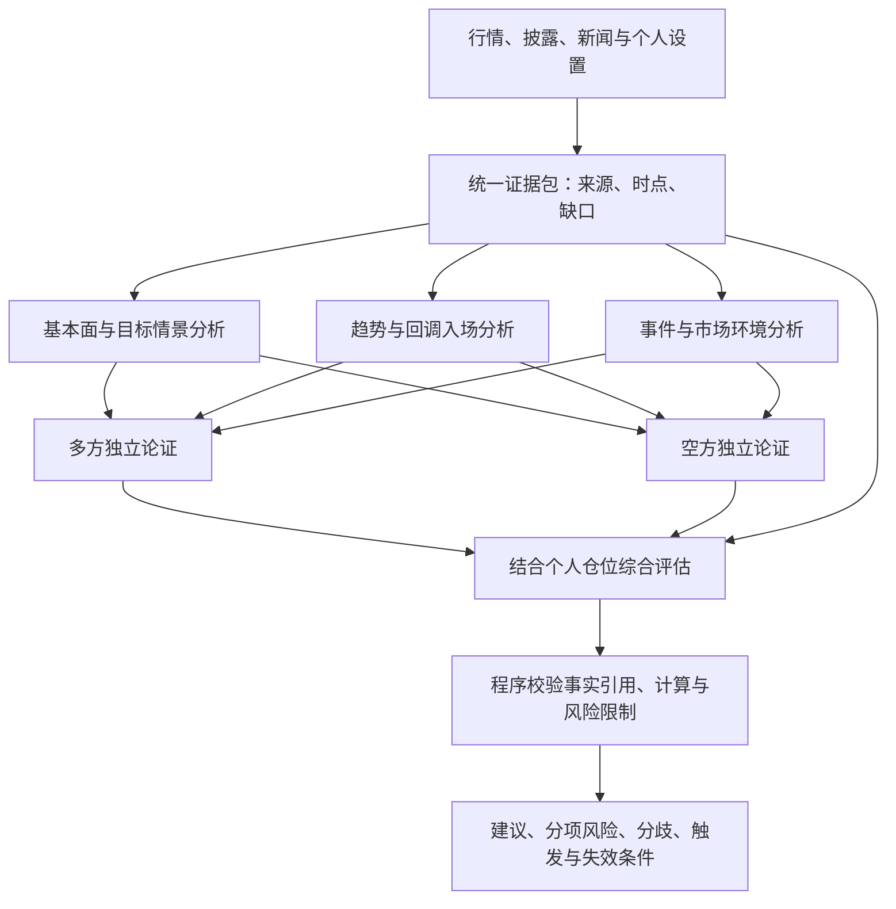

# 多智能体参考与美股数据来源调研

调研日期：2026-10-17。仅审阅公开代码与官方文档，未运行参考项目、测试付费接口或验证账户申请资格。

## 1. 参考项目与代码观察

参考：[astrbot_plugin_fund_analyzer](https://github.com/2529huang/astrbot_plugin_fund_analyzer)。审阅提交：`e942ebb1419b6d8ec64f11a75897fca0af40e4a6`。仅借鉴架构思路，本仓库没有复制其实现。

- `stock/debate_engine.py`：同一 AstrBot 模型提供商通过不同角色提示词执行六份分析，再进行多方、空方及裁判调用。引擎正常路径共九次调用，新闻摘要等前处理可能产生额外调用。
- `stock/data_collector.py`：按角色构造不同的数据包，适合借鉴数据整理与模型职责分离的方式。
- `stock/agent_prompts.py`：包含舆情、游资、风控、技术、筹码与大单角色。美股首版不直接照搬其中依赖特定市场数据的角色。
- 所审阅辩论路径中的“纳什均衡”主要体现为提示词中的推理要求，没有看到显式收益矩阵或均衡求解器；应视为角色辩论，而非已经验证的博弈模型。
- “信心度”“多空胜率”由模型文字输出后解析，所审阅路径没有预测概率校准。我们的产品不将其展示成统计胜率。
- `ai_analyzer/analyzer.py::get_news_summary` 调用模型总结新闻，传入日期、背景与搜索关键词；这条路径未见显式抓取新闻原文或检索工具调用。不能仅凭方法名认为已有可靠新闻采集，模型提供商自身是否另有检索能力需单独核实。
- 多方先写、空方再读多方并反驳的顺序具有不对称信息结构。我们的方案先让双方基于同一证据独立提出观点，再视分歧进行对等质询。

## 2. 适合本项目的研究流程

深度模式基线：三份分析并行、两份多空论证并行、一次综合，共六次模型调用；程序风险计算与校验不占模型调用。按调用和 token 预算限制，存在关键分歧时可选择追加一轮对等质询，最多再两次，不能无限辩论。

角色可用同一模型实现，独立性仅指首轮互不读取对方答案，不保证错误彼此独立。多模型作为可选配置，不能替代证据质量。不同角色必须明确观察期限，避免把短期回调和长期看好误判为互相否定。

各角色输出结论、证据 ID、反证、期限、可证伪条件及缺失信息。多空双方均可认定证据不足，不强制凑出观点或分歧。综合角色依据证据质量和个人约束，不按票数决定买卖，也不对冲突目标价简单平均。

综合角色可以读取原始证据，不能只读被前序角色加工后的摘要；若发现重大缺失，返回待补数据并暂停该项结论。单一角色超时可降级，基本面缺失时不生成估值型目标，模型失败不取消有效的已有监控。

## 3. 调用时机与效果验证

- 常规巡检：程序运行已定义条件，通常无需 AI。
- 普通日报：一次综合研判即可，复用有效研究结论。
- 首次深度分析、目标价复核、重要财报或关键分歧：启用多智能体模式。
- 保存输入、角色/提示版本、模型、耗时、token、失败状态和最终采用情况；深度结果按证据包版本缓存，重要新材料到达后失效。
- 通过前向模拟比较单模型与多角色模式，考察事实错误、预警质量、决策稳定性、交易表现及成本。多次调用并不预设带来更高收益。

## 4. 行情来源候选

| 来源 | 官方文档可确认的能力 | 本项目的用途与限制 |
| --- | --- | --- |
| Alpaca Market Data | 个人 Basic 为免费，实时美股限 IEX；文档列 Algo Trader Plus 为 99 美元/月，提供全美股交易所覆盖；提供 HTTP、WebSocket 和历史数据 | 优先验证接入。免费实时数据不等于全市场；全市场历史最近 15 分钟访问受订阅限制，按 FAQ 区分。基础实时流标的数有限，不能默认覆盖全部关注池 |
| Massive（原 Polygon.io） | 官方个人月付页面列免费日终数据、29 美元/月的 15 分钟延迟档、199 美元/月实时档；含不同历史深度与接口权益 | 独立行情候选。延迟档适合研究，盘中报告必须标记延迟，不伪装即时触价。实时还需核实交易所协议及个人资格 |
| 用户已有券商 API，例如 IBKR | IBKR 文档说明，大部分证券 API 实时行情需要相应订阅；站外 API 数据权益需核实 | 若已有合适账户可优先评估，可能减少重复订阅；运行会话、网关与限流增加维护成本，不默认采用 |

以上价格是本次官方页面快照，不构成购买建议；账户可申请性、实际权限、网络连通性、费用和长期可用性尚未实测。实现前只选择一个主行情源，其他通过接口预留。

## 5. 新闻、公司披露与宏观来源

### 公司事实：SEC EDGAR 与公司投资者关系网站

SEC 的 submissions 与 XBRL/companyfacts API 可获取披露索引和结构化财务数据，官方文档说明无需 API key。材料包括 10-K、10-Q、8-K 等；具体文件要按披露元数据定位，不把财务统计期间当作公开时间。

美光示例：公司 IR 网站提供季度结果、新闻、活动及 SEC filings 入口，可用于查业绩发布、指引和管理层材料。管理层预期与已经实现的业绩分开保存。IR 不是覆盖所有外部负面事件的新闻源，也不能保证每家公司有一致的 API。

### 新闻发现：Alpaca/Benzinga

Alpaca 历史新闻文档明确其新闻由 Benzinga 提供，可按标的接入；先核实账户下历史、实时及全文权限。

Benzinga 提供新闻 API 与推送产品，可作为直接付费来源。不同接入渠道的内容范围、时效与全文权益需要分别确认，不能认为任何 Benzinga 接口都拥有相同内容。

Alpaca/Benzinga 与直接 Benzinga 的同稿不属于两个独立信源。新闻源中的报道、分析师观点、传闻和公司声明要分类型；用于改变目标假设时尽可能回查原始公告或文件。

### 宏观背景：FRED 与原始发布机构

FRED API 可提供经济时间序列与发布相关数据，适合辅助市场环境分析。重大数据及政策决议必要时核对原发布机构。宏观数据会修订，历史分析保存当时获知版本或使用合适的历史版本数据，不能用修订后的数值假装当时已经知道。

## 6. 统一证据记录

行情保存 instrument、venue/feed、session、行情时点、抓取时点、延迟标记、单位与复权口径。

新闻与披露保存：证据 ID、供应商、原始发布者、原文链接、文档 ID、涉及标的、首次发布时间、更新时间、系统首次获知时间、内容摘要或有权访问的正文、事件分类及更正/撤回状态。

对相同稿件和转载聚类；同一事件的独立报道与单纯转载分别处理。旧新闻重发、标题更新和内容实质更新分别识别，防止反复触发。AI 的重要事实和目标调整理由必须引用存在的证据 ID。仅有标题时不推断未获得的正文细节。

数据源缺失的降级按能力执行：行情过期停价格触发，新闻不可用标注覆盖缺口，业绩与估值证据不足停估值型目标复核；不把局部失败包装成全面分析。

## 7. 首版建议组合

已确认用户可以接受延迟，优先免费数据方案。优先验证 Alpaca 免费历史 SIP 数据与 SEC EDGAR、公司 IR；Alpaca 新闻的实际免费权益另行验证，不因历史 beta 公告曾称免费就承诺现有账户可用。

Massive 或已有券商 API 作为可替换方案；直接 Benzinga 为新闻覆盖升级选项。暂不同时接入多个重复渠道。事件与公告的最小自动获取能力纳入首版，广泛新闻聚合和完整电话会转写服务后续扩展。

### 7.1 免费且接受延迟的首选实现

Alpaca FAQ 明确：未订阅 SIP 实时行情时，可以通过历史端点查询 SIP，只要 `end` 至少早于当前时间 15 分钟。`latest` 和 `snapshot` 的 SIP 仍需付费，不能混为同一权限。

因此首版拟使用明确的 `feed=sip`，以“当前时间减 15 分钟再加少量缓冲”为查询上限，轮询历史分钟数据并增量落库；不是订阅免费实时 SIP WebSocket。免费计划文档列历史请求额度 200 次/分钟，少量标的低频巡检优先批量、分页与缓存。

例如每 5 分钟巡检一次，提醒滞后可能接近数据延迟加一次巡检间隔，再加缓冲及处理时间，不能承诺精确 15 分钟。报告同时展示市场行情时点和系统分析时点，触发描述为“截至某时点已满足条件”，不声称当前价格仍满足或仍可按旧价成交。

收盘分析等待所需数据跨过免费访问窗口并校验完整性，不在刚收盘时假设已能读取最终日线。风险和入场建议强调日线与波段，不依赖秒级精度。

预期延迟与异常过期分开：按数据源已声明的延迟、巡检间隔及容差判断数据是否异常，不能把所有正常的 15 分钟延迟数据当作故障。证据包设置统一截止时点；之后才发布的新闻应触发新版本研判，不能与旧行情混成同一时点快照。

免费日终替代：Massive Basic 官方列两年历史、每分钟五次请求和日终可用性，适合补历史及收盘复盘，不能当作免费的当日盘中延迟数据源。

其他候选：Twelve Data Basic 页面列每分钟 8 credits、每日 800 credits；按标的和端点权重消耗，批量不自动减少总 credits，交易场所覆盖与个人报告使用权益需进一步确认。Alpha Vantage 常规免费额度为每日 25 次，实时和 15 分钟延迟美股属于其付费产品，暂不作为盘中主源。yfinance 自述非 Yahoo 官方关联项目，可作原型或人工核对，暂不承担主要持续监控。

“官方有免费档”不等于本项目已经验证长期可用。接入阶段用实际账户验证权限、部署连通性、缺失与错误响应，并做连续运行观察；主源不可用时保留已有数据与明确缺口，不暗中拼接不同口径。

## 8. A 股免费来源补充

仅补充扩展候选，美股仍为首个实施市场；本节基于公开文档，未进行接口连通及连续运行测试。

| 类型 | 候选 | 接入边界 |
| --- | --- | --- |
| 日线与盘中观察 | AKShare 的东财等数据适配 | 提供 `stock_zh_a_hist`、`stock_zh_a_spot_em` 及近期分钟数据；这是第三方数据访问封装，不是交易所承诺稳定的开放行情服务，实际时效和可用性需测 |
| 日终日线 | Tushare Pro | 当前权限表列 120 积分可访问免费非复权日线，50 次/分钟、8000 次/日；不能据此认为复权、财务、分钟与新闻均免费，分别核实权益 |
| 公司事实与公告 | 巨潮资讯、交易所公告栏目、公司官网 | 优先取得原始公告及披露时间；公开网页可查不代表提供无条件稳定的免费程序化 API |
| 个股新闻线索 | AKShare `stock_news_em` | 东财关键词检索，返回范围有限；检索命中不等于全部与该公司相关，需核对实体、来源和原文 |
| 市场快讯 | AKShare `stock_info_global_cls` | 财联社最近快讯，文档列最近 20 条；不能当作完整历史新闻库，采集间隔可能导致遗漏 |

免费优先的候选组合为：AKShare 日线与低频行情观察、Tushare 免费非复权日线作为可选核对、巨潮及交易所公告、个股新闻与快讯补充。行情自动切换前核对复权、成交量单位和覆盖范围，不能直接拼接。

接受延迟可以降低巡检频率，但不能把网页数据封装称为固定延迟 15 分钟的正式服务。若来源没有可验证的行情时间，保存抓取时间并标记行情时点未知，不把抓取成功等同于获得新行情；不声称新闻覆盖完整。公告事实、媒体报道和 AI 推断在证据包中分别标记。

BaoStock 官网列有日线、复权因子与知识库入口，可留作下一轮候选；本轮未完整核实当前免费范围和访问规则，不列为已验证主源。

## 9. 官方参考

- [参考插件代码与说明](https://github.com/2529huang/astrbot_plugin_fund_analyzer)
- [参考辩论引擎（固定提交）](https://github.com/2529huang/astrbot_plugin_fund_analyzer/blob/e942ebb1419b6d8ec64f11a75897fca0af40e4a6/stock/debate_engine.py)
- [参考新闻摘要代码（固定提交）](https://github.com/2529huang/astrbot_plugin_fund_analyzer/blob/e942ebb1419b6d8ec64f11a75897fca0af40e4a6/ai_analyzer/analyzer.py)
- [Alpaca 行情计划](https://docs.alpaca.markets/us/docs/about-market-data-api)
- [Alpaca 行情 FAQ](https://docs.alpaca.markets/us/docs/market-data-faq)
- [Alpaca 新闻来源](https://docs.alpaca.markets/us/docs/historical-news-data)
- [Massive 行情计划](https://massive.com/pricing?product=stocks)
- [Massive 原 Polygon.io 平台说明](https://www.massive.com/stocks)
- [IBKR API 行情订阅](https://www.interactivebrokers.com/docs/general/market-data-subscriptions/introduction)
- [SEC EDGAR API](https://www.sec.gov/search-filings/edgar-application-programming-interfaces)
- [美光投资者关系](https://investors.micron.com/)
- [美光季度结果入口](https://investors.micron.com/financials/quarterly-results/default.aspx)
- [Benzinga 新闻 API](https://www.benzinga.com/apis/in/cloud-product/stock-news-api/)
- [FRED API](https://fred.stlouisfed.org/docs/api/fred/)
- [Twelve Data 免费计划与 credits](https://twelvedata.com/pricing)
- [Alpha Vantage 免费额度与延迟行情限制](https://www.alphavantage.co/support/)
- [yfinance 项目说明](https://github.com/ranaroussi/yfinance)
- [AKShare 股票、新闻及快讯接口文档](https://akshare.akfamily.xyz/data/stock/stock.html)
- [Tushare 当前积分与频次权限](https://tushare.pro/document/2?doc_id=290)
- [巨潮资讯](https://www.cninfo.com.cn/)
- [上交所公告](https://www.sse.com.cn/disclosure/listedinfo/announcement/)
- [BaoStock 官网与知识库入口](https://www.baostock.com/)
